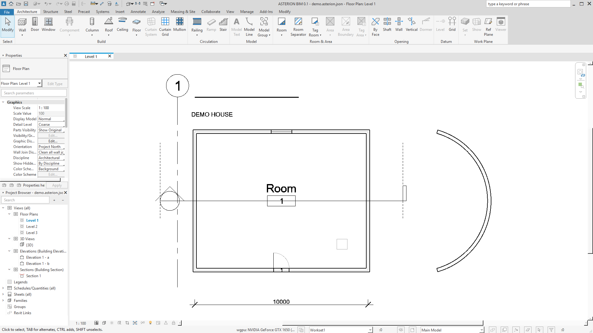
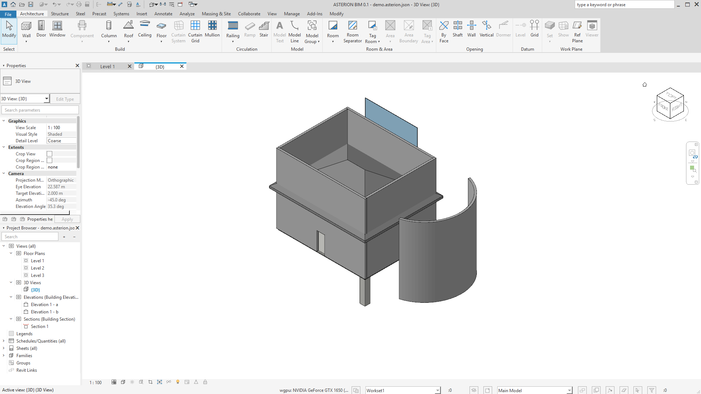
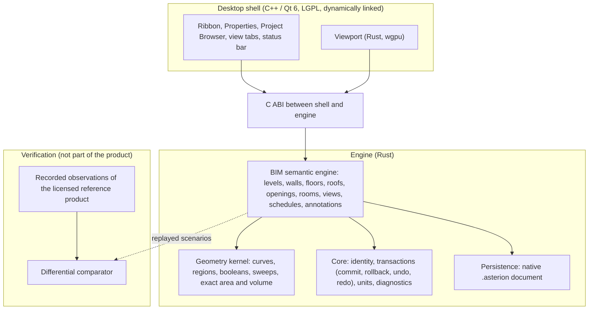

# ASTERION BIM


An independent, open-source building information modelling (BIM) application, built from scratch. Its goal is to let
people model, document and exchange architectural projects with a tool they can inspect, extend and run without a
proprietary licence.

> **This is an ALPHA demo, not a finished product.** The project is opening to the public gradually, so that people can
> test it and tell us what is wrong. Expect missing features, rough edges and crashes. Do not use it for real project
> deliverables. Everything below says what works, what does not, and how we know.

> **Working name.** "ASTERION" is a working name. Its availability as a trademark has **not** been confirmed and it may change.

[What is this](#what-is-this) | [Screenshots](#screenshots) | [Status at a glance](#status-at-a-glance) | [Measured numbers](#measured-numbers) |
[Known limitations](#known-limitations) | [What alpha means](#what-alpha-means) | [Architecture](#architecture) |
[Try it](#try-it) | [Contributing](#contributing) | [Roadmap](#roadmap) | [Legal position](#legal-position) |
[Licence](#licence) | [En espanol](#en-espanol)

## What is this

ASTERION BIM is a desktop BIM application for Windows. It has its own semantic building model (levels, walls, floors,
roofs, openings, rooms, grids, views and so on), its own geometry kernel, its own native document format
(`.asterion`, a versioned text format), a desktop shell with ribbon, properties palette and project browser, and a
viewport that draws plans, 3D views, sections, elevations and schedules from the model.

Its modelling workflows and results are measured against one fixed reference: recorded observations of a single version of a
leading commercial BIM application (see [Legal position](#legal-position) and [NOTICE](NOTICE)). Compatibility is a goal, not a
claim: each statement below links to a number, and the numbers include the failures.

What it is **not**: it is not a plugin for another product, not an IFC viewer, not a web page, and it does not need
any other BIM product installed to run.

## Screenshots

Both images are real captures of the ASTERION alpha window (1920 x 1080), taken from a small demo house that was
**created from scratch with ASTERION's own tools** (wall, door, window, floor, roof, room, column, curtain wall, stair, grid,
dimension, tag, text and section tools, driven through the real window by the project's self-test; see
[Try it](#try-it)). No model from any other product or any third party is shown.



*Floor plan of the demo house, drawn from the model by the engine. The ribbon, properties palette and project browser are
the application shell.*



*The 3D view of the same model (13 solids). Stairs and railings are not drawn in 3D yet, see
[Known limitations](#known-limitations).*

Captured from a build of development-tree commit `3d71d951` on 2026-10-20 with the shell's own `--snapshot` option.

## Status at a glance

| Area | State in this alpha |
|---|---|
| Walls (straight and arc), joins, location line, compound layers | Works; the engine matches recorded reference scenarios on most fields, with known gaps in arc walls and joins at unusual angles (see numbers) |
| Doors and windows hosted in walls | Works |
| Floors, ceilings, footprint roofs, sloped floors | Works for the common cases |
| Rooms, levels, grids | Works |
| Columns, curtain walls | Works; not yet counted as validated against the reference |
| Views: plan, 3D, section, elevation, schedule, sheet | Plan, 3D, section, elevation, callout and schedule views work (selection and Properties in every view type); sheets are basic |
| Annotation: aligned and linear dimension, tag, text | Basic |
| Stairs and railings | Placed with correct counts; **no 3D body yet**, nothing in section or 3D |
| Editing | Move, copy, rotate, mirror, offset, scale, array, split, trim / extend, join geometry, wall joins, pin, delete, paste, match type, undo / redo work. Align, cut, split with gap, repeat, displace and similar are disabled with the reason |
| Saving | Native `.asterion` format only |
| Structure, steel, precast, MEP (systems), analysis, collaboration | **Not supported.** The tabs exist in the window; their commands are disabled |
| Windows installer | Exists, **unsigned** |
| Other operating systems, other versions of the reference application | Not supported |

Every ribbon control that does not work is drawn in its place, disabled, with the reason in its tooltip. Nothing in the
window is decorative and no value shown is sample data: what you see is read from the engine after every edit, undo and
open.

## Measured numbers

Every figure here comes from files the project generates itself, was produced on the date and commit shown, and is
reproducible by the maintainers. A "commit" is a commit of the project's private development tree (the source is
published module by module, see [Legal position](#legal-position)). Failures are listed, not hidden.

### Engine versus the reference product (differential tests)

How it is measured: scenarios were run in a licensed installation of the reference product through its public programming
interface, and their results recorded. The same scenarios are replayed in the ASTERION engine and compared **field by field**.
This is a comparison against *observations*, run by the project; it is not endorsed, audited or certified by anyone else.

| Measure (summary generated 2026-10-20, development-tree commit `b51a55bc`) | Value |
|---|---:|
| Recorded scenario rounds | 55 |
| Fields compared | 921,013 |
| Fields equal | **918,405** (99.72 % of those compared) |
| Fields different | **2,608** |
| Fields missing on one side | **211** |
| Fields recorded but **not compared** | **1,134,320** |

Read the last two rows as seriously as the first. "99.72 %" is of the fields that are compared, and more than a million
recorded fields are not compared at all: mostly element kinds ASTERION does not model yet, parameter dumps, and part of
the solid vertex data. They do **not** count as parity. Of the compared vertex data, 4,853 solid vertex sets (167,133
coordinates) are checked and 702 of those sets differ. The largest remaining groups of differences are arc walls and wall joins at other
angles. The summary is regenerated on every build.

### Application self-tests

| Measure | Result |
|---|---|
| Milestone verification, commit `02df9b7c`, 2026-10-20 02:58 | **ALL PASS**: 641 self-tests PASS, 0 FAIL; live performance 7 PASS; drawing-experience targets 20 of 20 met |
| Windows installer test, development-tree commit `b51a55bc`, 2026-10-20 | silent install **OK**; 695 edit self-tests and 39 demo steps run from the installed copy (**0 FAIL**); snapshot **OK**; uninstall removes the install folder. On the one test machine, which had earlier test builds installed, the Start-menu shortcut stayed after uninstall |
| "Build a house from scratch" demo script, part A, run 2026-10-20 on the build used for the screenshots (`3d71d951`) | 26 steps, 26 PASS, 0 FAIL; 28 committing clicks, median 2.5 ms, 90th percentile 5.2 ms, worst 10.5 ms (press to end of redraw) |

The self-tests drive the real window and read every result back from the engine. They show that the application does what
its authors scripted. They do not show that every behaviour equals the reference product; the comparison above is what
addresses that, and it is incomplete.

### Commands and plan

| Measure (regenerated 2026-10-20 at development-tree commit `b51a55bc`) | Value |
|---|---:|
| Commands drawn on the ribbon (architecture, modify, annotate, view) | 154 |
| ... wired to the engine and working | 83 |
| ... of those, validated against the reference behaviour | 54 |
| Internal roadmap items done / in progress / total | 45 / 21 / 82 (54.9 % done) |

"Validated" is a stricter bar than "works": the behaviour has been specified from observation and the engine's result has
been compared with the reference. The 29 working-but-not-validated commands are labelled `implemented` internally, never
counted as parity.

## Known limitations

This list is deliberately long. If something you need is not here, assume it is missing.

- **Stairs and railings have no 3D body.** Counts of risers, treads and landings are modelled; geometry is not generated,
  so nothing appears in 3D or in a section.
- **Many ribbon commands are disabled**, each with its reason in the tooltip: all remaining annotation kinds
  (spot elevations, detail items, legends, scope boxes, matchlines, area plans, ramps, model text and more), most of the
  View tab beyond plan / 3D / section / elevation / schedule / sheet, loadable-family authoring, and a long tail of flyout commands.
- **Selection and properties:** click, hover pre-selection, Tab cycling, add / remove and window / crossing selection work in plan, section, elevation, callout and 3D views, and the Properties palette follows the selection. 3D window / crossing selection ignores occlusion; railing types have no Type Properties page; viewports on a sheet cannot be dragged yet; there are no selection filters.
- **No MEP, structure, steel, precast, analysis or collaboration.** Architecture only.
- **One reference version only.** No other version of any product is a target.
- **Windows only** (tested on Windows 11, x64, with a Vulkan-capable GPU). No Linux, no macOS.
- **The installer is unsigned.** Windows SmartScreen will warn you. Check the SHA-256 listed in the release notes.
- **No IFC, DWG, DXF or PDF export or import yet.** The native `.asterion` format may change between alpha builds.
- **Several behaviours are the engine's own choice, not matched to the reference**: the frame of an elevation view, which
  elements a section cuts, how a schedule names itself, the arc-wall drawing gesture, and what a plain duplicate copies.
  They are marked as such inside the project and are not counted as parity.
- **Columns, curtain walls and the default 3D view work but are not counted as validated** yet.
- **The visual line of the window** follows the layout conventions of the reference product's workflow on purpose, so its
  users do not have to relearn it. It has not been audited by a third party, and the icons and artwork are ASTERION's own drawings.
- **Crashes and data loss are possible.** Save often and keep your originals.

## What alpha means

- Features are incomplete and may change or disappear. File formats may change without migration.
- Numbers above are a snapshot, not a promise. They move every day, in both directions.
- There is no support and no warranty (see the licence). Bug reports are welcome and read, but not on a schedule.
- It is for testing, learning and feedback. Do not use it on projects that matter.
- "Opening gradually" means: first this README and the project's rules, then alpha builds for testers, then source code module
  by module as each one's origin can be documented. Nothing is hidden on purpose, and nothing is published before it can be explained.

## Architecture



Design rules that the project holds itself to:

- **Derived state is never stored.** Geometry and computed parameters are a pure function of the semantic model, so they
  cannot go stale. The window shows what the engine says after every edit.
- **Deterministic local kernels.** Rust for the engine (no garbage-collection pauses), no services in the modelling loop.
- **One source for every view.** Plan, 3D, section, elevation and schedule are drawn from the same element geometry.
- **The product never depends on another BIM product.** The verification tools sit outside it and are never shipped.
- **Every claim has a number**, and the number includes the failures.
- The engine has 184 transactional operations (count at development-tree commit `3bb125f`); every edit is undoable.

## Try it

**Requirements:** Windows 11 x64 and a Vulkan-capable GPU. The installer is about 22 MB; installed size has not been measured. Tested on one machine configuration so far (one discrete NVIDIA GPU), so other hardware is unknown territory.

1. **Download.** The first alpha build, `AsterionBim-0.1.0-setup.exe` (about 22 MB), is on this repository's
   [Releases page](https://github.com/Asterion-OpenDesign/Asterion-bim/releases/tag/v0.1.0-alpha.1) (marked pre-release).
2. **Check the file.** The release notes list its SHA-256. In PowerShell: `Get-FileHash .\AsterionBim-0.1.0-setup.exe -Algorithm SHA256`.
3. **Install.** The installer is unsigned, so SmartScreen will ask for confirmation. It installs per machine into
   `C:\Program Files\ASTERION` by default; `MSIINSTALLPERUSER=1` installs for the current user without elevation.
   Uninstall from Windows "Installed apps".
4. **Try the 10-minute tour** (the full [alpha testing guide](docs/guides/alpha-testing-guide.md) lists what to test per ribbon tab and what not to expect). File > New, then with the real tools: draw four walls (Wall tool), an arc wall, a door and a
   window, a floor, a ceiling and a roof, a room, a column, a curtain wall, a stair with railings, a level and a grid, a dimension,
   a tag and a text note; make a section and an elevation; open the 3D view; make a schedule of walls; save and reopen.
   The shell ships the same script as a self-check: `asterion-shell.exe --selftest-demo` runs it through the real window and
   prints one PASS or FAIL line per step (it runs in an off-screen window and takes about 20 seconds).
5. **Tell us what happened.** Open an issue with: the build, what you did, what you expected,
   what you saw, and a screenshot if it helps. The build is the version shown in the window title. Do **not** attach files you have no right to share, and never attach models that
   belong to a client or employer.

The engine crates are published as source (see [Build the engine](#build-the-engine)); the desktop shell, the viewport and the
native-format crates are not published yet and arrive module by module (see [Legal position](#legal-position)).

## Build the engine

The workspace holds three crates: `asterion-core` (identity, transactions, diagnostics), `asterion-geom` (geometry kernel) and
`asterion-bim` (the semantic engine). They need Rust 1.80 (declared) or newer and no system libraries.

```
cargo build --workspace --locked
cargo test --workspace --locked
```

Verified locally with `cargo test --workspace --locked --offline` (Rust 1.99.0, Windows): 774 tests passed (asterion-core 20, asterion-geom 222, asterion-bim 532) and 1 ignored (a timing probe), none failed. The continuous-integration workflow in `.github/workflows` has not run yet, and the declared minimum Rust version has not been tested.

Behavioural rules are cited in the code as `Spec <id>` and stated in [docs/specs/engine-rules.md](docs/specs/engine-rules.md); what is
not known is listed in [docs/open-questions.md](docs/open-questions.md). Third-party crates: [THIRD_PARTY_NOTICES.md](THIRD_PARTY_NOTICES.md).

## Contributing

Right now the most valuable contributions are **test reports, bug reports and sharp questions**. Open an issue.

Code contributions are welcome as modules are published, under rules designed to keep the project clean:

- Read [CONTRIBUTING.md](CONTRIBUTING.md) and [docs/PROVENANCE_POLICY.md](docs/PROVENANCE_POLICY.md) first.
- Do **not** submit anything derived from proprietary code, binaries, SDK files, icons, fonts or resources you are not licensed
  to redistribute, from the output of a decompiler or disassembler, or from leaked or confidential material.
- Behaviour you observed in a product you are licensed to use may be described in your own words in a specification
  (`docs/specs/`). Say how you observed it. Do not paste proprietary text or data.
- Every commit carries a `Signed-off-by:` line (Developer Certificate of Origin 1.1).
- Run `python tools/provenance_gate.py` before opening a pull request. A passing gate is necessary, not sufficient.

Security reports: see [SECURITY.md](SECURITY.md); please use private vulnerability reporting, not a public issue.

## Roadmap

Honest and ordered by dependency; dates are targets, not promises.

| When | What |
|---|---|
| Now | Public foundations (this repository), provenance gate and CI; first alpha installer for testers in preparation |
| Target 2026-10-23 | Alpha demo of the **core architecture scope**: straight and arc walls, doors, windows, floors, roofs, ceilings, rooms, stairs, railings, columns, curtain walls, levels, grids, plan / 3D / section / elevation / sheet / basic schedules, with every item in scope either validated against the reference or listed here as unverified |
| Next | Close the listed differences (arc walls, joins at other angles), give stairs and railings a 3D body, widen selection and annotation, regenerate the numbers on every build |
| Then | Publish source modules one by one with specification, tests and provenance entry; build instructions verified from a clean checkout; signed installer |
| Later, one discipline at a time | Structure, then MEP, then the rest. IFC and other open exchange formats. Nothing here is started |

## Legal position

- **Independent project.** ASTERION is not affiliated with, endorsed by or sponsored by any commercial software vendor.
  Third-party product names are trademarks of their owners; they are used only to describe which workflows ASTERION is
  made to be compatible with (nominative use) and are listed in [NOTICE](NOTICE). No certification and no completeness of
  compatibility is implied.
- **Independent implementation, clean-room policy.** ASTERION's code is written for this project. The product contains no
  third-party vendor code, binaries, SDK files, fonts or other resources, and its icons and artwork are ASTERION's own.
  Behaviour is described in written specifications in the project's own words and verified by differential tests against
  observations of the licensed reference product. The project does not circumvent any licence, activation or access control.
- **What we do and do not claim about provenance.** The rules are in [docs/PROVENANCE_POLICY.md](docs/PROVENANCE_POLICY.md) and
  are enforced by an automated gate in CI. Under those rules a module is called independently developed only when its entry in
  [provenance/LEDGER.md](provenance/LEDGER.md) shows who wrote it, from what, and the separation from excluded material. That
  ledger has an entry for each of the three engine crates published so far (`asterion-core`, `asterion-geom`, `asterion-bim`);
  none of those entries claims the separation that rule 5 requires, so none of the crates is described as independently
  developed. We do not claim a formally
  certified clean-room process, and a passing gate is not a legal opinion.
- **Third-party components.** The shell uses Qt 6 under LGPL-3.0, dynamically linked; Rust dependencies are permissively
  licensed. Each release lists them in a third-party notice.
- **Trademark of the name.** Not confirmed (see the top of this page).
- **No private data.** No project of any third party is used or shown. Images in this repository are captures of ASTERION
  running on its own demo model.

## Licence

Source code: [Apache License 2.0](LICENSE). Documentation, images, fonts, names and trademarks are not automatically covered by
that licence; each is addressed explicitly when added. The images in `docs/images/` are captures of the ASTERION application and
may be reused to describe ASTERION, with the name "ASTERION" subject to the trademark note above. See [NOTICE](NOTICE).

## En espanol

**ASTERION BIM** es una aplicacion BIM de codigo abierto e independiente (licencia Apache-2.0), escrita desde cero. Sus flujos de trabajo
y resultados se miden contra una referencia fija (una sola version de una aplicacion BIM comercial) y se demuestran con mediciones. **Es una demo ALPHA, no un
producto final**: el proyecto se abre poco a poco al publico para que se pruebe y se reporten fallos.

- **Estado medido (2026-10-20):** 918.405 de 921.013 campos comparables coinciden con las observaciones del producto de
  referencia (99,72 %), pero hay 2.608 diferencias, 211 ausentes y 1.134.320 campos registrados que **no** se comparan y por
  tanto no cuentan como paridad. De 154 comandos dibujados, 83 funcionan y 54 estan validados.
- **Limites:** escaleras y barandillas sin cuerpo 3D; secciones y alzados importados no se dibujan; muchos comandos de la cinta
  estan deshabilitados con su motivo; sin MEP ni estructura; una sola version de referencia; solo Windows; instalador sin firmar.
- **Posicion legal:** proyecto independiente, sin afiliacion ni respaldo de ningun proveedor comercial; los nombres de productos de
  terceros son marcas de sus duenos y solo se usan para describir la compatibilidad (ver [NOTICE](NOTICE)). El nombre ASTERION es provisional y su disponibilidad
  como marca no esta confirmada.
- **Como colaborar:** abre un issue con tu informe de prueba; lee [CONTRIBUTING.md](CONTRIBUTING.md) y
  [docs/PROVENANCE_POLICY.md](docs/PROVENANCE_POLICY.md) antes de proponer codigo.
